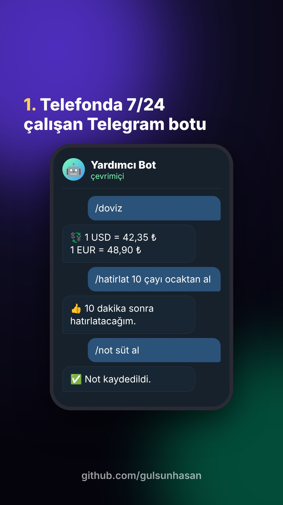

# 📱 Termux Telegram Bot — Telefonda 7/24 Çalışan Türkçe Bot

Bilgisayar yok, sunucu parası yok. Eski bir Android telefon ya da tablet + Termux ile **10 dakikada** kendi Telegram botunu kur, 7/24 çalıştır.

> 🇬🇧 *A ready-to-use Turkish Telegram bot template that runs 24/7 on an Android phone with Termux — notes, reminders, exchange rates, auto-restart and auto-start on boot.*

<p align="center"></p>

## ✨ Özellikler

| Komut | Ne yapar |
|---|---|
| `/not süt al` | Not kaydeder (kişiye özel, SQLite) |
| `/notlar` · `/notsil 3` | Notları listeler / siler |
| `/hatirlat 10 çayı al` | 10 dakika sonra mesaj atar |
| `/doviz` · `/doviz GBP` | Güncel döviz kuru (TL karşılığı) |
| `/durum` | Açık kalma süresi, kullanıcı sayısı |

Ayrıca:
- 🔁 **Çökerse kendini yeniden başlatır** (`baslat.sh`)
- 🔋 **Ekran kapanınca durmaz** (`termux-wake-lock`)
- 🚀 **Telefon açılınca otomatik başlar** (Termux:Boot)
- 🧩 Yeni komut eklemek 5 satır — kendi botuna temel yap

## 🚀 Kurulum (Termux)

**1. Bot token al:** Telegram'da [@BotFather](https://t.me/BotFather) → `/newbot` → isim ver → token'ı kopyala.

**2. Termux'u kur:** [F-Droid](https://f-droid.org/packages/com.termux/)'den indir (Play Store sürümü eski).

**3. Termux'ta şunları yaz:**
```bash
pkg install -y git
git clone https://github.com/gulsunhasan/termux-telegram-bot
cd termux-telegram-bot
bash kurulum.sh
./baslat.sh
```
Kurulum token'ını soracak, yapıştır. Bitti — Telegram'da botuna `/start` yaz. 🎉

> Bilgisayarda (Linux/Mac/Windows) da çalışır: `pip install -r requirements.txt`, `.env` dosyasına token'ı yaz, `python bot.py`.

## 🔋 7/24 çalışması için ipuçları

- Android ayarlarında Termux için **pil optimizasyonunu kapat**.
- Bildirim çubuğundaki Termux bildiriminden **"Acquire wakelock"**a bas (script bunu otomatik yapar).
- **Otomatik başlatma:** F-Droid'den **Termux:Boot** kur, bir kere aç, sonra:
  ```bash
  mkdir -p ~/.termux/boot
  cp boot/start-bot ~/.termux/boot/
  chmod +x ~/.termux/boot/start-bot
  ```

## 🧩 Kendi komutunu ekle

`bot.py` içine:
```python
async def selam(update, context):
    await update.message.reply_text("Aleyküm selam! 👋")

app.add_handler(CommandHandler("selam", selam))
```

## ❓ Sık sorunlar

| Sorun | Çözüm |
|---|---|
| `BOT_TOKEN bulunamadı` | `.env` dosyasında `BOT_TOKEN=` satırını kontrol et |
| Bot bir süre sonra cevap vermiyor | Pil optimizasyonunu kapat, wakelock aç |
| Hatırlatıcılar kayboldu | Bot yeniden başlarsa bekleyen hatırlatmalar silinir (bilinen sınır) |

## 🤝 Katkı

Hata bulduysan ya da fikrin varsa **Issue** aç, Pull Request gönder. Projeyi faydalı bulduysan ⭐ vermeyi unutma!

## 📄 Lisans

MIT — istediğin gibi kullan, değiştir, dağıt.

---
Geliştiren: **Hasan Gülsün** · Özel bot ya da otomasyon ihtiyacın varsa LinkedIn'den ulaş.
